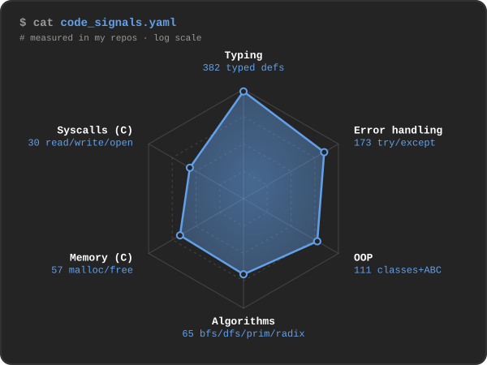
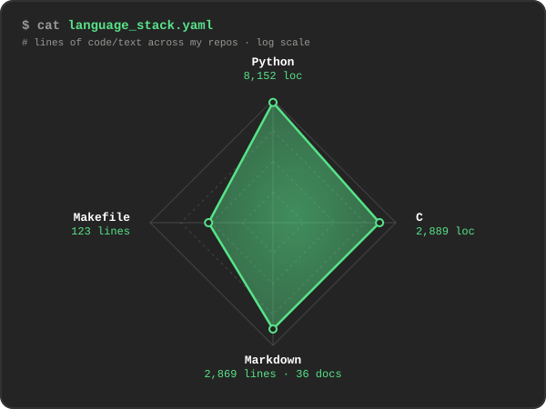
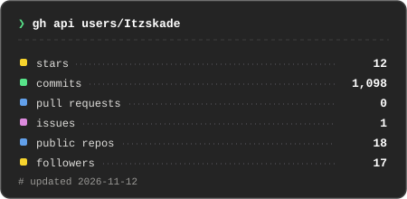
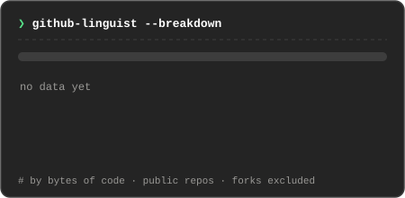

<!--
  ⚠ README.md is generated from this file (python3 generate.py).
  Edit HERE. Tokens like 62a0ea and 242424 are replaced with the active
  theme's colors (without '#'), so the external cards match the SVGs.
-->

---

## `$ whoami`

---

## `$ cat tech-stack.yaml`

| `├─ ✦ languages:`      `C · Python` | `├─ ▥ databases:`      `MySQL · PostgreSQL` |
| :--- | :--- |
| `├─ ▤ containers:`      `Docker` | `╰─ ✎ workflow:`      `Linux · Git · GitHub · Neovim` |

---

## `$ ls ~/42/finished-projects`

|  Project | Overview | Built with |
|  :------ | :------- | :--------- |
| [Libft](https://github.com/Itzskade/Libft) | Custom C library: 45 functions, from `ft_atoi` to `ft_split`, plus linked lists (`t_list`) | C · Makefile · `libft.a` |
| [Printf](https://github.com/Itzskade/Printf) | Recreate `printf()` with variadic arguments, built on top of Libft | C · `stdarg` · Libft |
| [Get_next_line](https://github.com/Itzskade/Get_next_line) | Read one line at a time from a file descriptor, with a bonus for multiple fds | C · `read` · `malloc` · `BUFFER_SIZE` |
| [Push Swap](https://github.com/Itzskade/Push_Swap) | Sort integers with two stacks: optimized for ≤ 5 elements, LSD radix sort (base 2) for larger inputs | C · Libft · 42 Norm |
| [Python_Piscine](https://github.com/Itzskade/Python_Piscine) | 11 modules: OOP, exceptions, collections, imports, abstract classes, polymorphism, Pydantic and functional programming | Python · typing · abc · pydantic |
| [A-Maze-ing](https://github.com/Itzskade/A-Maze-ing) | Team project: maze generation (DFS, randomized Prim), BFS solver, themes and config parser | Python · pydantic · mypy · flake8 |
| [Call_me_maybe](https://github.com/Itzskade/Call_me_maybe) | Local LLM-based function-calling system using constrained decoding to generate structured, validated function calls from natural language prompts | Python · LLM · constrained decoding · pydantic |
| [Fly-in](https://github.com/Itzskade/Fly-in) | Drone routing simulation: finds efficient routes across a map handling obstacles, hub and connection capacities, movement restrictions and multiple drones moving turn by turn | Python · pathfinding · simulation |
| [Codexion](https://github.com/Itzskade/Codexion) | Multithreaded simulation inspired by the Dining Philosophers problem, with FIFO and EDF scheduling: concurrent programmers competing for shared resources | C · `pthread` · mutexes · condition variables |

---

## `$ kubectl get signals --all-namespaces`

 

 

---

## `$ connect --socials`

